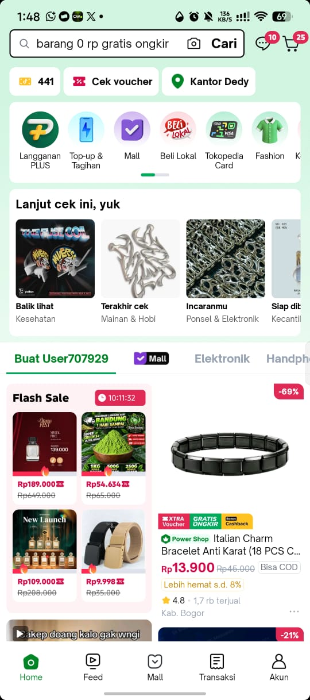
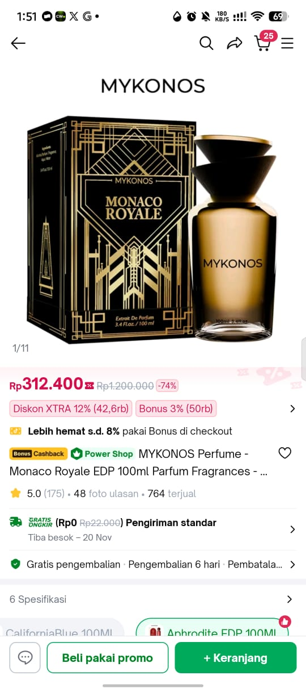
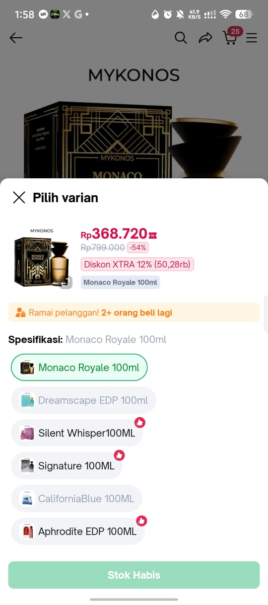

### PPM TEAM (Pemuda Pantang Mundur)

# Audit UX Aplikasi Nyata & Aturan Wireframe Katalog UMKM

## 1. Pasangan Aplikasi Pembanding (Opsi 1)
* **Aplikasi UX Nyaman (+):** **Tokopedia (`https://www.tokopedia.com/`)** — Platform *e-commerce* populer dengan alur pencarian produk, navigasi kategori, dan transaksi *checkout* yang intuitif serta familiar.
* **Aplikasi UX Membingungkan (-):** **Portal SSCASN BKN (`https://sscasn.bkn.go.id/`)** — Situs web pendaftaran seleksi ASN/Sekolah Kedinasan dengan struktur informasi birokratis dan alur pengguna yang kaku.

### Bukti Tangkapan Layar (Perbandingan Antarmuka)

| Aplikasi UX Nyaman (+) — Tokopedia | Aplikasi UX Membingungkan (-) — SSCASN BKN |
| :---: | :---: |
|  |  |
| *Navigasi familiar: kolom cari di atas & ikon kategori jelas* | *Menu menumpuk* |
|  |  |
| *Tombol CTA menempel di bawah (mudah dijangkau ibu jari)* | *Buku Petunjuk dan Helpdesk dipisah padahal bisa dijadikan satu menjadi Bantuan Pendaftaran* |
|  |  |
| *Tombol Beli dinonaktifkan dan muncul peringatan bahwa stok habis* | *navigasi timeline pengadaan menjadi satu padahal banyak jenisnya* |
---
# Isi Tabel Audit Berbasis 4 Prinsip Emas 

| Prinsip Emas UX | Temuan di Aplikasi Nyaman (+)  *(Contoh: Tokopedia)* | Temuan di Aplikasi Membingungkan (-)  *(Contoh: Website SSCASN)* | Saran Perbaikan Konkret |
| :--- | :--- | :--- | :--- |
| **1. Kebiasaan Pengguna**  *(Pola familiar)* | **Tata Letak Mudah Ditebak:** Kolom pencarian berada di bagian paling atas, ikon keranjang di pojok kanan atas, serta menu utama di bawah sesuai dengan kebiasaan umum saat menggunakan aplikasi belanja. | **Teks Padat Menyerupai Dokumen Kertas:** Tampilan awal dipenuhi oleh kalimat pengumuman yang panjang dan padat tanpa pembagian visual yang jelas, sehingga pengguna bingung mencari tombol untuk mulai mendaftar. | Ubah tata letak halaman utama agar lebih fokus pada tindakan utama, letakkan tombol **Daftar/Masuk** secara jelas di bagian atas atau tengah layar, serta buat ringkasan alur pendaftaran menggunakan langkah-langkah visual (ikon berurutan). |
| **2. Tombol & Jangkauan Jempol**  *(CTA jelas)* | **Tombol Aksi Mudah Dijangkau:** Tombol aksi utama seperti "Beli" atau "+ Keranjang" selalu berada di bagian paling bawah layar dengan ukuran besar dan warna yang mencolok, sangat ramah untuk penggunaan satu tangan. | **Tombol Berukuran Kecil & Sulit Ditekan:** Tautan atau tombol penting berukuran kecil, tersembunyi di tengah paragraf teks, atau berada di pojok atas layar yang sulit dijangkau jari. | Perbesar ukuran tombol utama agar memenuhi lebar layar bagian bawah pada tampilan ponsel, serta gunakan warna yang kontras tinggi agar langsung menarik perhatian pengguna untuk melanjutkan langkah. |
| **3. Visibilitas Status Sistem**  *(Loading/Error)* | **Umpan Balik Sistem Jelas:** Ketika halaman dimuat, terdapat kerangka bayangan konten (*skeleton screen*) yang menunjukkan proses sedang berjalan, dan terdapat pesan ramah beserta tombol "Coba Lagi" saat jaringan bermasalah. | **Layar Kosong & Kode Error Rumit:** Saat peladen (*server*) sedang padat, halaman hanya berputar tanpa kejelasan waktu tunggu, atau menampilkan kode kesalahan teknis sistem yang membingungkan orang awam. | Tampilkan indikator proses atau perkiraan waktu tunggu saat sistem sibuk, serta ganti pesan kesalahan teknis dengan bahasa yang ramah dan manusiawi (contoh: *"Sistem sedang padat, silakan coba beberapa saat lagi"*). |
| **4. Pencegahan Kesalahan**  *(Validasi/Form)* | **Pemeriksaan Isian Langsung:** Sistem langsung memberikan tanda centang hijau jika benar atau peringatan merah seketika jika format nomor telepon/alamat salah sebelum tombol lanjut ditekan. | **Kesalahan Baru Muncul di Akhir:** Pengguna harus mengisi formulir yang sangat panjang terlebih dahulu, dan baru diberitahu ada kesalahan atau ukuran berkas yang tidak sesuai setelah menekan tombol kirim. | Terapkan validasi otomatis di setiap kolom isian secara langsung setelah pengguna selesai mengetiknya (misalnya pengecekan jumlah digit NIK atau ukuran berkas sebelum berpindah ke kolom berikutnya). |
