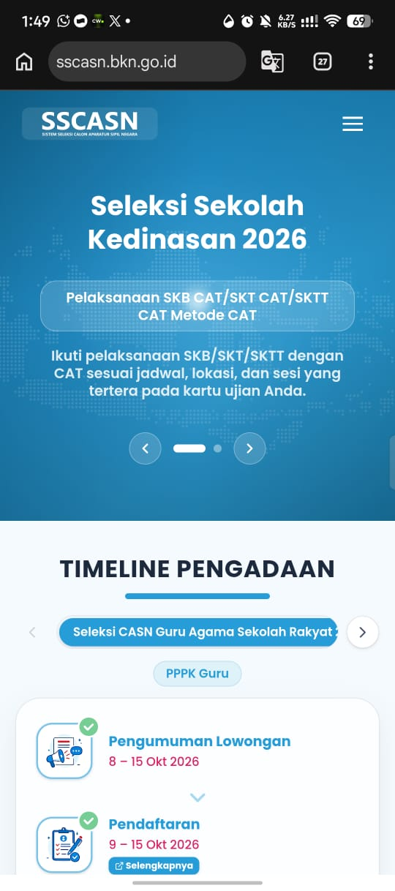
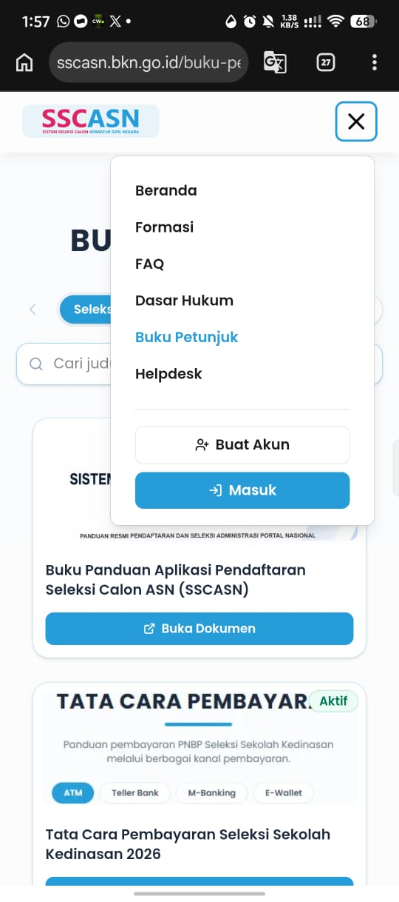
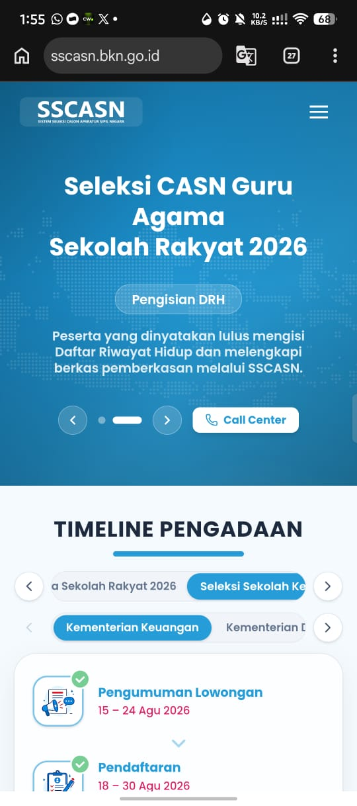

### PPM TEAM (Pemuda Pantang Mundur)

# Audit UX Aplikasi Nyata & Aturan Wireframe Katalog UMKM

## 1. Pasangan Aplikasi Pembanding (Opsi 1)
* **Aplikasi UX Nyaman (+):** **Tokopedia (`https://www.tokopedia.com/`)** — Platform *e-commerce* populer dengan alur pencarian produk, navigasi kategori, dan transaksi *checkout* yang intuitif serta familiar.
* **Aplikasi UX Membingungkan (-):** **Portal SSCASN BKN (`https://sscasn.bkn.go.id/`)** — Situs web pendaftaran seleksi ASN/Sekolah Kedinasan dengan struktur informasi birokratis dan alur pengguna yang kaku.

### Bukti Tangkapan Layar (Perbandingan Antarmuka)

| Aplikasi UX Nyaman (+) — Tokopedia | Aplikasi UX Membingungkan (-) — SSCASN BKN |
| :---: | :---: |
|  |  |
| *Navigasi familiar: kolom cari di atas & ikon kategori jelas* | *Menu menumpuk* |
|  |  |
| *Tombol CTA menempel di bawah (mudah dijangkau ibu jari)* | *Buku Petunjuk dan Helpdesk dipisah padahal bisa dijadikan satu menjadi Bantuan Pendaftaran* |
|  |  |
| *Tombol Beli dinonaktifkan dan muncul peringatan bahwa stok habis* | *navigasi timeline pengadaan menjadi satu padahal banyak jenisnya* |
---
