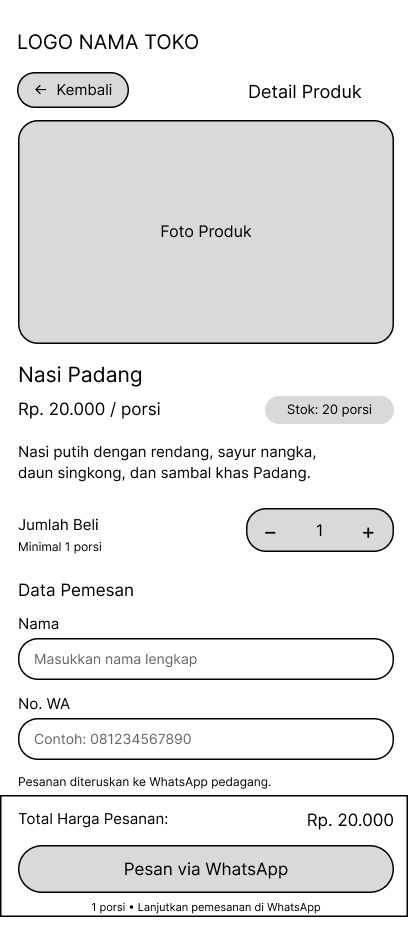
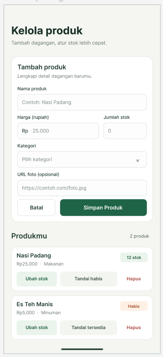

# Wireframe Katalog UMKM — [PPM]

**Link File Figma:** [*(https://www.figma.com/design/XkwlWOKwCpBofuqiB8YdCo/Wireframe-Katalog-UMKM----PPM-?node-id=0-1&p=f&t=xyDTewtGogrRcQo1-0)*]

---

## 1. Tangkapan Layar Wireframe (Hasil Manual & AI)

* **Halaman 1 — Katalog Utama:**

* **Halaman 2 — Detail Produk:**

* **Halaman 3 — Dashboard Merchant:**

  
---

## 2. Catatan Kritik Figma AI & Keputusan Squad
* **Saran AI yang Dipakai:** Menempatkan tombol aksi utama pada area yang mudah dijangkau satu jempol serta memperjelas label status stok (*Tersedia* / *Habis*) agar pengguna awam langsung paham kondisi produk tanpa menebak. *(Alasan dipakai: sesuai kebutuhan pembeli awam dan alur order cepat ke WhatsApp tanpa membuat tata letak berantakan).*
* **Saran AI yang Ditolak:** Menambahkan banyak elemen dekoratif, *badge* promosi berlapis, atau komponen visual penuh warna/kompleks sejak tahap *wireframe*. *(Alasan ditolak: bertentangan dengan aturan wireframe hitam-putih untuk menguji struktur terlebih dahulu serta berisiko membuat layar terasa penuh bagi pembeli awam).*

---

## 3. Hasil Evaluasi Alur (Mode Present / Prototype)
* **Alur Navigasi Utama:**
  * **Halaman 1 (Katalog Utama) → Halaman 2 (Detail Produk):** Klik kartu produk atau tombol detail untuk melihat spesifikasi dan form pemesanan WA.
  * **Halaman 2 (Detail Produk + Form Pemesanan WA) → Halaman 1 (Katalog Utama):** Klik tombol kembali atau batal untuk kembali ke daftar katalog.
  * **Navigasi Kelola Toko → Halaman 3 (Dashboard Merchant):** Akses pengelolaan produk dan stok (tambah/ubah stok, *Tandai habis* / *Tandai tersedia*, *Hapus*).
* **Hasil Uji Mode Present:**
  * *Jangkauan satu jempol:* Tombol aksi utama diposisikan agar nyaman diakses satu tangan, namun jarak antar-tombol (seperti pada aksi kartu di Dashboard Merchant) perlu diperhatikan agar tidak terlalu rapat.
  * *Pengecekan tombol buntu:* Seluruh tombol navigasi utama sudah dihubungkan antar-*frame*; elemen pelengkap yang belum punya tujuan alur ditandai untuk dilengkapi atau dirapikan sebelum ekspor final.
  * *Bukti 3 Aturan UX Wajib:*
    1. **Kebiasaan pengguna:** Menggunakan pola daftar katalog, halaman detail produk, dan tombol aksi yang familiar bagi pengguna ponsel.
    2. **Visibilitas status sistem:** Menampilkan status stok secara eksplisit (termasuk kondisi stok kosong/*Habis* dan jumlah stok) serta umpan balik form yang jelas.
    3. **Pencegahan kesalahan:** Menyediakan pesan *error* berbahasa Indonesia yang ramah saat form pemesanan belum lengkap serta membedakan status produk yang siap dipesan vs habis.
